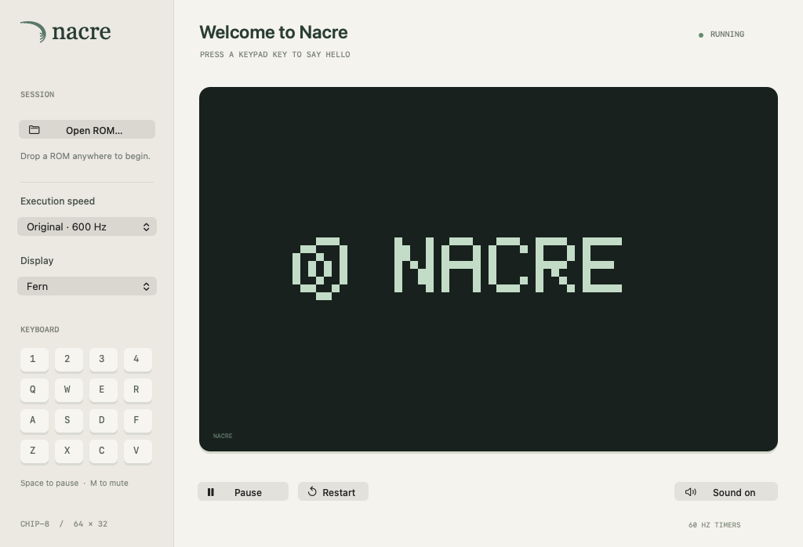
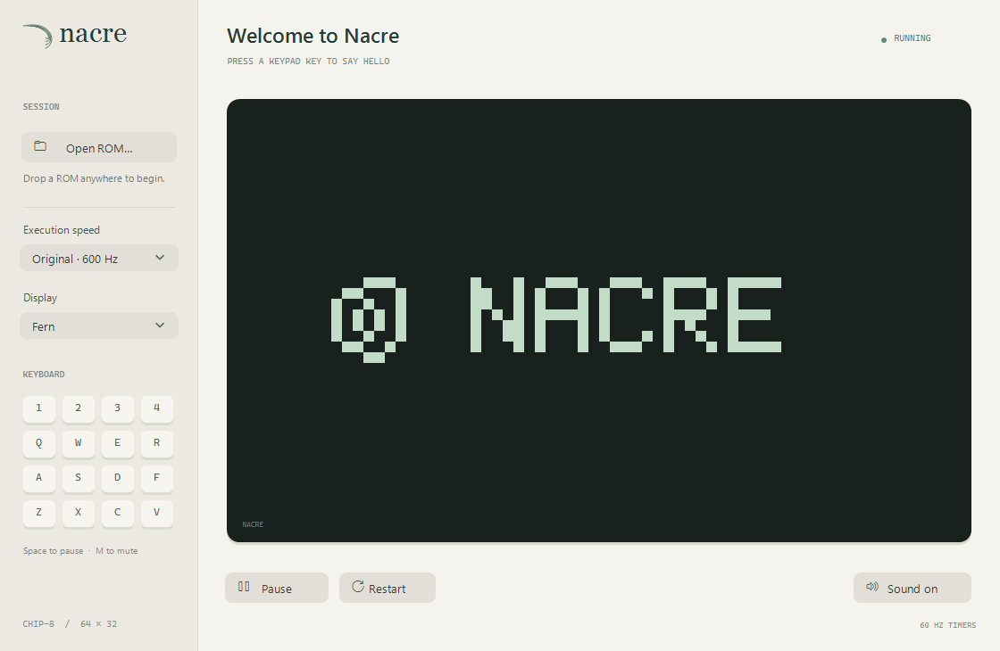

# Nacre

A compact CHIP-8 interpreter with native Mac and Windows apps, a portable SDL3 frontend for Linux, and a terminal interface. All of them use the same C emulator core and sound oscillator. A Game Boy (DMG) core sits alongside it, and all three desktop frontends play Game Boy cartridges. See [Game Boy core](#game-boy-core).



*The actual AppKit interface, captured by the Mac CI runner.*



*The Windows interface, captured by the app's own `--snapshot` mode.*

## Build and play

You need a C99 compiler, `make`, and SDL2 development files for live audio. `pkg-config` is used to find SDL2.

```sh
make
./play path/to/game.ch8
# Or run a specific ROM directly:
./nacre path/to/game.ch8 --play
```

The live sound is a smooth 440 Hz tone that follows the CHIP-8 sound timer. The `m` key mutes and unmutes it. Use `--sound off` for a silent play session. SDL2 is only needed for live audio; without it, the program still builds for headless use and WAV capture.

The terminal uses half-block characters by default to fit the display into 64×16 cells. Use `--render full` for double-width blocks. In play mode, use lowercase letters for the standard CHIP-8 key map; uppercase `R` resets the game:

```text
1 2 3 4        1 2 3 C
q w e r   →    4 5 6 D
a s d f        7 8 9 E
z x c v        A 0 B F
```

| Key | Action |
| --- | --- |
| `p` | Pause or resume |
| `R` | Reset the ROM |
| `+` / `-` | Increase or decrease speed |
| `m` | Mute or unmute sound |
| `Esc` | Quit |

## Desktop app

The Mac and Windows apps share one design: a warm pearl sidebar beside a dark,
pixel-perfect display. Both have native menus and file dialogs, drag-and-drop ROM
loading, recent files, a live keyboard guide, pause/restart/sound buttons, and Fern,
Amber, and Pearl palettes. Speed, palette, and mute preferences are saved
automatically (Windows also remembers the window position). The emulator pauses
and releases held keys when the window loses focus.

Build with CMake 3.20+ and a C compiler (Xcode Command Line Tools on Mac, Visual
Studio 2022+ or Build Tools with the C++ workload on Windows):

```sh
cmake -S . -B build -DCMAKE_BUILD_TYPE=Release
cmake --build build --config Release
```

The first configure downloads pinned SDL3 source. SDL3 is linked statically and
its license is bundled. Mac uses AppKit for the interface and SDL3 for audio;
Windows uses plain Win32 and GDI+ for the interface (no extra runtime needed) and
SDL3 for audio. Linux still uses the basic SDL3 window. The emulator core is shared.

The Mac result is `build/Nacre.app`. Windows produces a single `Nacre.exe` (icon and
welcome ROM are built in) plus `THIRD_PARTY_NOTICES.txt`; with a multi-config
generator such as Visual Studio it lands in `build/Release/`. Linux produces `Nacre`
alongside `assets/hello.ch8` and `THIRD_PARTY_NOTICES.txt`. Launch opens the
bundled demo. Use Open ROM, drag a file onto the window, or pick File → Open Recent
(Windows also accepts a ROM path on the command line). Restart uses the loaded
bytes, so it still works if the original file was moved.

| Action | Mac | Windows | SDL frontend (Linux) |
| --- | --- | --- | --- |
| CHIP-8 keypad | `1–4`, `QWER`, `ASDF`, `ZXCV` | Same (by physical key position) | Same |
| Game Boy buttons | Arrows or `WASD`, `X`/`K` = A, `Z`/`J` = B, `Return` = Start, `Delete` or right `Shift` = Select | Arrows or `WASD`, `X`/`K` = A, `Z`/`J` = B, `Enter` = Start, `Backspace` or right `Shift` = Select | Same |
| Game Boy fast-forward | Hold `Tab` (4×, silent) | Same | Same |
| Game Boy save state / load / next slot | `F5` / `F7` / `F6` (also Session menu) | `F5` / `F7` / `F6` | `F5` / `F7` / `F6` |
| Rebind Game Boy keys | Session → Controls… (`⌘,`) | Session menu → Controls… | `F10` |
| Game Boy speed / palette | Sidebar popups | Sidebar or Session/View menus | `F3` / `F4` (shown in the title bar) |
| Pause / resume | `Space` or `⌘P` | `Space` or `Ctrl+P` | `Space` |
| Restart ROM | `⌘R` or `F2` | `Ctrl+R` or `F2` | `F2` |
| Sound | `M` | `M` | `M` |
| Open ROM | `⌘O` | `Ctrl+O` | `Ctrl+O` |
| Full screen | View menu / `⌃⌘F` | `F11` or `Alt+Enter` (`Esc` leaves) | Window manager |
| Quit | `⌘Q` | `Ctrl+Q` | `Ctrl+Q` / `Esc` |

The [Desktop builds workflow](https://github.com/tdotlab/nacre/actions/workflows/desktop.yml)
uploads unsigned artifacts. Mac CI targets macOS 11+ with both Intel and Apple
Silicon architectures. It also launches the AppKit app, exercises basic controls
and key dispatch, runs the Game Boy key and frame path on a stand-in cartridge
(captured as `Nacre-preview-gb.png`), and captures the actual interface as
`Nacre-preview.png`.
These automated checks do not establish audible output or real MacBook acceptance.
The preview is unsigned and unnotarized. A normal downloadable release still needs
signing and notarization.

Windows CI builds with the MSVC toolchain, runs the same style of self-check
(pause, mute, restart, physical key down/up, the Game Boy key and frame path on a
stand-in cartridge, then a capture of the real window),
and uploads the unsigned `Nacre.exe`. Windows SmartScreen will warn about it until
it is code-signed. Those checks do not establish audible output or hands-on
acceptance on real hardware.

Linux build dependencies are listed in `.github/workflows/desktop.yml`.
For a UI capture from a built app:

```sh
build/Nacre.app/Contents/MacOS/Nacre --snapshot /absolute/path/preview.png   # Mac
build\Release\Nacre.exe --snapshot C:\absolute\path\preview.png              # Windows
```

## Interpreter behavior

Nacre implements the classic CHIP-8 instruction set with these choices: `8xy6` and
`8xyE` shift `Vx`; `Fx55` and `Fx65` leave `I` unchanged; `Bnnn` adds `V0`; and
sprites wrap at screen edges. `Fx0A` waits for a new key press and its release.
SUPER-CHIP and XO-CHIP are not implemented. Legacy `0nnn` system calls are ignored.
Seven classic Timendus ROMs ran for 20,000 simulated cycles without an emulator
error. This was a crash smoke check; their displayed results have not been reviewed.

The default speed is 10 instructions per 60 Hz virtual frame (600 instructions per
second). `--speed N` changes CPU speed without changing timer or display rates.

## ROMs

The Mac app bundles an original welcome ROM, `assets/roms/nacre.ch8`: it draws Nacre and toggles a sparkle with a short beep when a keypad key is pressed and released. Regenerate it with `python3 tools/build-demo.py`; check reproducibility with `--check`.

`hello.ch8` draws a small legacy demo. `sound.ch8` sets the buzzer timer and loops, so it is a quick way to hear the sound output.

Pass any compatible `.ch8` file to `./play` or `./nacre`. To download the optional game collection for the terminal picker's local library, run:

```sh
./get-roms.sh
./play
```

The collection is cloned into `.roms-cache/`; `roms/` is a local symlink to its `games/` directory. Both paths are ignored by Git. The ROM collection comes from [kripod/chip8-roms](https://github.com/kripod/chip8-roms).

## Headless use

```sh
./nacre hello.ch8 --cycles 50
./nacre path/to/rom.ch8 --cycles 2000 --dump framebuffer.txt
./nacre sound.ch8 --cycles 300 --sound wav --sound-file sound.wav
./nacre --selftest
```

Headless mode runs 2,000 CPU cycles by default at 600 cycles per virtual second and
prints the 64×32 framebuffer as `#` and `.`. `--dump PATH` writes it to a file;
`--dump -` writes to standard output. `--sound wav` records a mono 48 kHz WAV,
including silence; CHIP-8 timers tick at 60 Hz, so 600 cycles produce one simulated
second. The default output path is `nacre.wav`.

`make clean` removes the compiled executable. The ROMs and generated WAV files are not tracked by Git.

## Game Boy core

`src/gb/` is a separate C99 core for the original Game Boy (DMG), exposed through
`include/gb.h`. It covers:

- An SM83 CPU stepped per memory cycle, with timers and interrupts.
- A per-dot PPU covering background, window and sprites.
- OAM DMA, the serial port clocked from the DIV divider, the joypad, and the OAM corruption bug.
- The post-boot register, DIV and I/O state of a DMG.
- MBC1 (including multicarts), MBC2, MBC3 (with the real-time clock) and MBC5 cartridges.
- Battery saves as standard `.sav` files: cart RAM, plus the common 48-byte RTC trailer for MBC3.
- The four-channel APU, mixed down to 48 kHz stereo.

Game Boy Color-only cartridges are refused with a clear error.

The Windows app opens `.gb` files (and Color carts that also run on the original
model) from Open ROM, drag and drop, recent files, or the command line. It decides
by the cartridge header, not the extension. It shows the 160×144 screen in four
shades of the chosen palette, with D-pad, A/B, Select and Start keycaps. The speed
control switches to Half, Normal and Double, and the sound is stereo. Battery
cartridges save to a `.sav` file beside the ROM (`Tetris.gb` → `Tetris.sav`). The
save is written about a second after the game changes it, and again on restart,
on loading another ROM, and on exit. Each write goes to a temporary file first and
then replaces the old save. A `.sav` that doesn't fit the cartridge is left
untouched. `Nacre.exe ROM --seconds N --snapshot out.png` runs a cartridge for N
seconds and captures the window; a snapshot run never writes saves or states.
Like the Linux frontend, the Windows app runs every game through the
system-agnostic core interface, so fast-forward and save states also work for
CHIP-8 programs opened from a file.

The Mac app does the same in its own design: the same keys (`Return` for Start,
`Delete` or right `Shift` for Select), `.sav` handling and stereo sound, and it
accepts `.gb`/`.gbc` from Open, Finder, recent files and drag and drop. Like the
other desktop apps it runs every game through the core interface. Its speed popup
shows CPU rates for CHIP-8 and real-time multiples for Game Boy, and remembers each.
`Nacre.app/Contents/MacOS/Nacre ROM --seconds N --snapshot out.png` works as on Windows.

The Linux SDL frontend does the same in its plainer window: the same keys, the
same `.sav` handling, stereo sound, and integer-scaled output. It runs games through
the system-agnostic core interface, so `F3` (speed), `F4` (palette), fast-forward
and save states work for CHIP-8 programs as well; the bundled welcome program has
no file to keep states beside. A fault shows the message and halts the game until
`F2` or another file, instead of closing the window. You can also drop a file onto
the window.

### Controllers, save states, fast-forward and rebinding

All three frontends share the same Game Boy input features.

A controller (anything SDL3 recognises as a gamepad) works with no setup: D-pad or left
stick, east/north for A, south/west for B, Start and Back. A right shoulder button or
either trigger fast-forwards while held. Holding the left shoulder button turns Start,
Back and the top face button into save state, load state and next slot. Only the focused,
unpaused window listens.

Save states have four slots, stored beside the ROM as `Tetris.state1` to `Tetris.state4`.
The bundled demo and ROMs opened without a path have nowhere to put them. A state is
tied to the build that wrote it: a state from another game, another build, or a damaged
file is rejected and the running game is left alone. Loading discards queued audio and
keeps battery saves safe by marking the cartridge RAM dirty.

Fast-forward runs at 4× while the key is held and mutes the Game Boy audio, because
four-times audio is a squeal.

Every action has two keys. The rebinding window (see the table above for how to open it)
lists them: click or select a cell and press the new key. A key belongs to one action, so
binding it takes it from the old owner. `Esc` cancels, `Delete` clears, and reserved keys
(pause, mute, restart, `Esc`, the modifiers) are refused. Bindings persist: the Windows registry,
Mac `NSUserDefaults`, and `controls.txt` in the SDL preferences folder on Linux.

The core is checked against public test ROMs, which are fetched into the ignored cache and never committed:

```sh
python3 tools/get-gb-test-roms.py   # Blargg, dmg-acid2, Mooneye Test Suite
make test                           # includes tests/test_gb (116 ROM checks + built-ins)
```

`tests/test_gb --run ROM --seconds N --dump out.pgm --press start:9` runs one ROM headlessly. It holds a button at a given time and writes the final frame, which is how real games are smoke-tested.

## License

Copyright (c) 2026 tdotlab. Nacre is free software: you can redistribute it and/or
modify it under the terms of the [GNU General Public License](LICENSE) as published
by the Free Software Foundation, either version 3 of the License or (at your option)
any later version. It comes with no warranty. Every build ships the license text as
`LICENSE` beside the app, and the source is this repository.

The apps statically link SDL3 (zlib license, compatible with the GPL), whose notice
ships beside them as `THIRD_PARTY_NOTICES.txt`. Downloaded game ROMs in
`.roms-cache/` belong to their own authors and are not covered by this license.

Nacre was MIT licensed until 2026-11-17. Copies obtained from earlier commits stay
under the MIT terms they came with; new work is GPL.

## Development

Run `make test` for the SDL-free scheduler, key-wait and Game Boy checks (fetch the GB test ROMs first, or those checks are skipped). The desktop source,
cross-platform build, and remaining Mac acceptance work are tracked in
[the roadmap](docs/ROADMAP.md).
